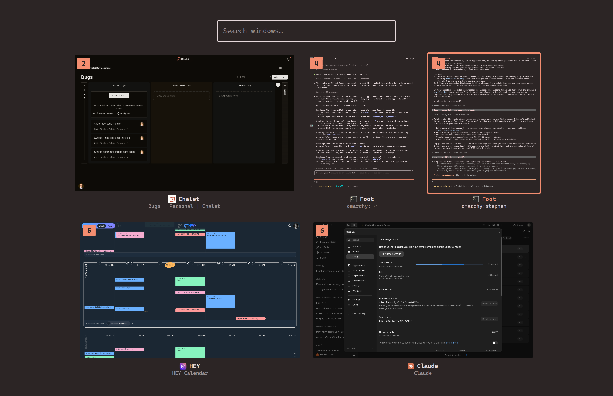

# Window Overview for Omarchy

Every open window, from every workspace, as a live thumbnail. Type to find a
window, press its workspace's number, or pick it with the arrow keys, and you
are there. The same view doubles as a Mac-style Alt+Tab switcher.

A plugin for the [Omarchy](https://omarchy.org) shell.



## What it does

- **Overview.** One key shows all windows in workspace order, each in its real
  shape, with its app icon, title and workspace number. Thumbnails are live,
  also for windows on workspaces you are not looking at.
- **Search.** Just type. Matching is fuzzy, as in fzf, over app names and
  titles; several words must all match (`chr git`).
- **Jump by number.** With nothing typed, a number key goes to the window on
  that workspace (`0` is workspace 10), the most recently used one if there are
  several.
- **Close from the overview.** `Ctrl+W` or a middle click closes a window and
  leaves the overview open for the next one.
- **Alt+Tab.** Hold `Alt`, tap `Tab` to step through the windows, most recently
  used first, and let go to jump. A quick `Alt+Tab` flips to the previous window
  without showing anything.
- **Themed.** Colours and fonts are those of the Omarchy menu and follow theme
  changes live.

## Install

```bash
omarchy plugin add https://github.com/sschuez/omarchy-window-overview --enable
```

A plugin cannot bind keys, so add them yourself in `~/.config/hypr/bindings.lua`.
The plugin listens on Hyprland global shortcuts, which reach the shell without
starting a process on every keypress.

```lua
-- Window Overview. Pick any free key.
o.bind("SUPER + E", "Window Overview", hl.dsp.global("window-overview:toggle"))

-- Optional: no compositor fade, so the overview is simply there.
hl.layer_rule({ match = { namespace = "window-overview" }, no_anim = true, animation = "none" })
```

For the Alt+Tab switcher, add this as well. It replaces Omarchy's own
`Alt+Tab`, which cycles the windows of the current workspace.

```lua
-- Hold Alt, tap Tab to step through windows, let go of Alt to jump.
-- A release bind on Alt is skipped once another key (Tab) was pressed during
-- the hold, so Alt is watched while a switch is under way instead.
local switching = false
local function watch_alt()
  if hl.is_key_down("Alt_L") or hl.is_key_down("Alt_R") then
    hl.timer(watch_alt, { timeout = 15, type = "oneshot" })
  else
    switching = false
    hl.dispatch(hl.dsp.global("window-overview:switch-commit"))
  end
end
local function switch_window(direction)
  return function()
    hl.dispatch(hl.dsp.global("window-overview:switch-" .. direction))
    if not switching then
      switching = true
      watch_alt()
    end
  end
end
o.rebind("ALT + TAB", "Switch window", switch_window("next"), { repeating = true })
o.rebind("ALT + SHIFT + TAB", "Switch window back", switch_window("previous"), { repeating = true })
```

To hold the switcher on Super instead (like Cmd+Tab on a Mac), use `SUPER`
and `Super_L` / `Super_R` above. Omarchy binds Super+arrows to move focus, so
the arrows never reach the switcher; route them to it while switching, with
`switch-previous`, `switch-next`, `switch-up` and `switch-down`:

```lua
local function arrow(direction, step)
  return function()
    if switching then
      hl.dispatch(hl.dsp.global("window-overview:switch-" .. step))
    else
      hl.dispatch(hl.dsp.focus({ direction = direction }))
    end
  end
end
o.rebind("SUPER + LEFT", "Focus on left window", arrow("l", "previous"), { repeating = true })
o.rebind("SUPER + RIGHT", "Focus on right window", arrow("r", "next"), { repeating = true })
o.rebind("SUPER + UP", "Focus on above window", arrow("u", "up"), { repeating = true })
o.rebind("SUPER + DOWN", "Focus on below window", arrow("d", "down"), { repeating = true })
```

Hyprland reloads its config on save. Check it with
`hyprctl reload && hyprctl configerrors`.

## Keys

| Key | In the overview |
| --- | --- |
| Any text | Search |
| `←` `→` `↑` `↓`, `Tab` / `Shift+Tab`, `Ctrl+N` / `Ctrl+P`, `Alt+[` / `Alt+]` | Move the selection |
| `Enter`, click | Jump to the window |
| `1`–`9`, `0` | Jump to the window on that workspace (while nothing is typed) |
| `Ctrl+W`, `Alt+W`, middle click | Close the window |
| `Ctrl+U` | Clear the search |
| `Esc` | Clear the search, then close |
| Your overview key, click on the backdrop | Close |

While switching with Alt held: `Tab` and `Shift+Tab` step, the arrow keys move,
`W` closes the selected window, `Esc` cancels, and letting go of `Alt` jumps.

## Good to know

- Windows on special workspaces (the scratchpad, windows minimized to the dock)
  are left out.
- `SUPER+W` still closes the window that was focused before the overview
  opened, as Hyprland handles that key itself. Use `Ctrl+W` for the selected one.

## Remove

```bash
omarchy plugin remove io.github.sschuez.window-overview
```

Then delete the lines you added to `~/.config/hypr/bindings.lua`. Omarchy's own
`Alt+Tab` returns with the next `hyprctl reload`. The plugin writes no files and
keeps no state.

## Requirements

Omarchy 4 or newer: the Quickshell-based shell and Hyprland configured in Lua.
No other dependencies. Thumbnails use Hyprland's window capture through
Quickshell.

## Development

`Windows.js` holds the search, ordering and layout logic, free of Qt:

```bash
node test/windows.test.js
```

## Credits

Built after reading three earlier plugins for the same idea, with thanks:
[prov4/omarchy-mission-control](https://github.com/prov4/omarchy-mission-control),
[AndyWeiBoan/omarchy-mission-control](https://github.com/AndyWeiBoan/omarchy-mission-control)
(whose findings on window capture and untrusted window titles were a great help) and
[rmacy/omarchy-mission-control](https://github.com/rmacy/omarchy-mission-control)
(for watching the Alt key from Hyprland).

## License

MIT, see [LICENSE](LICENSE).
